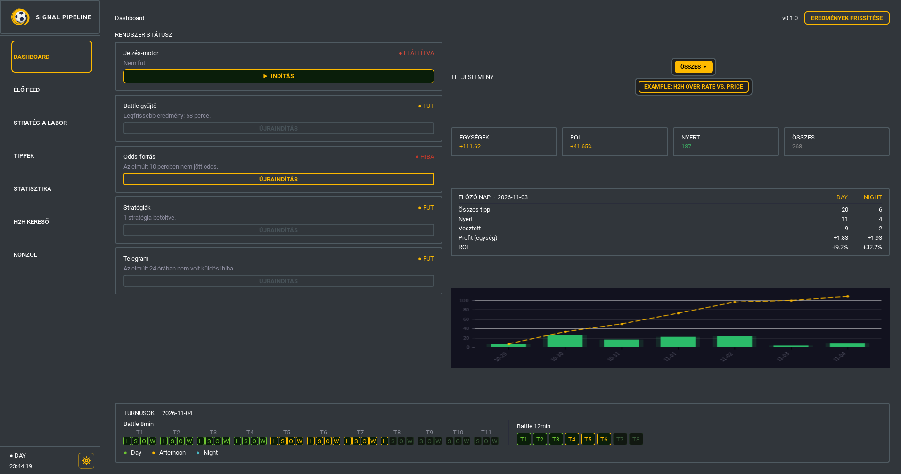
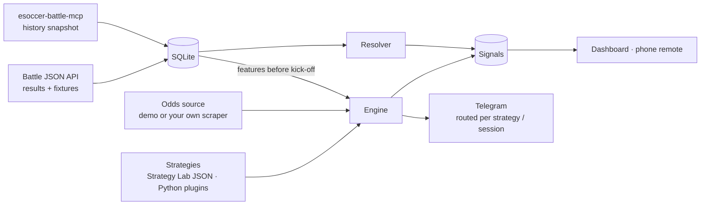
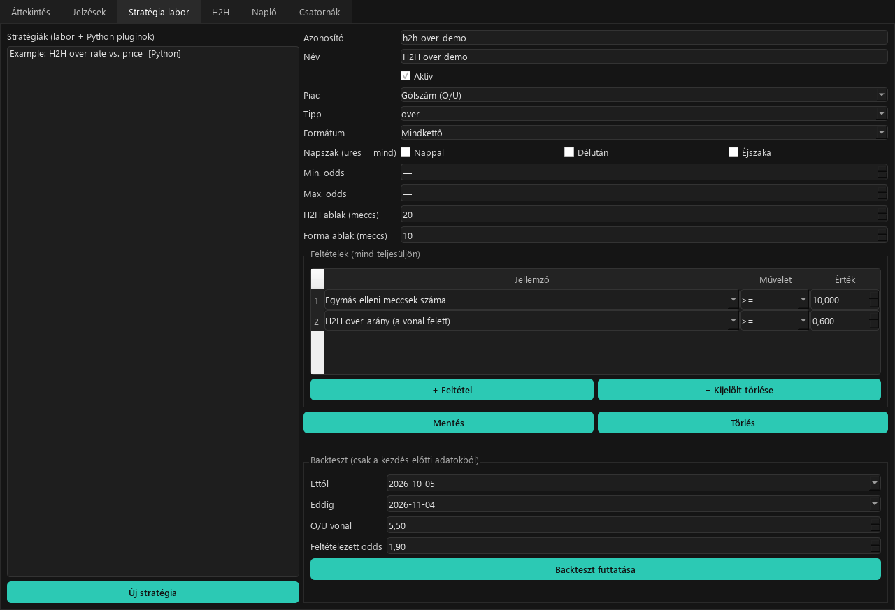
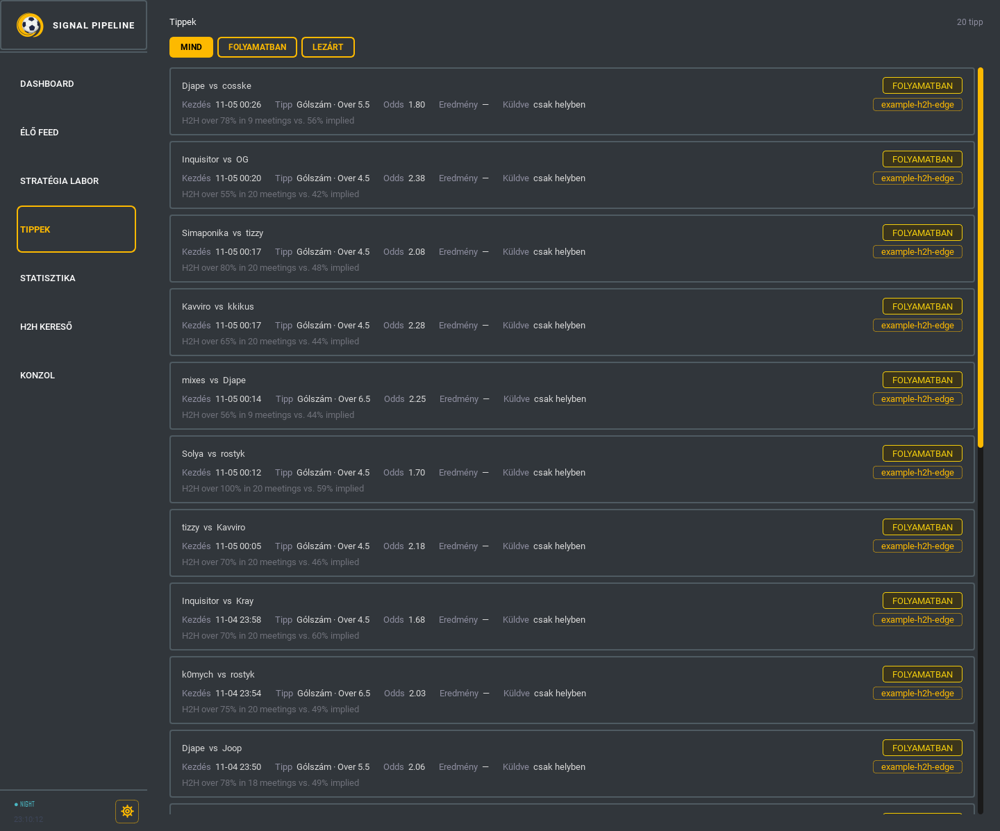
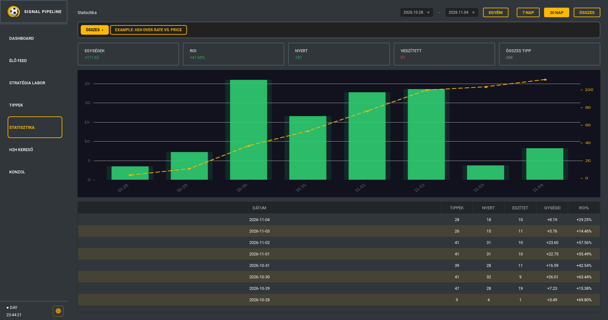
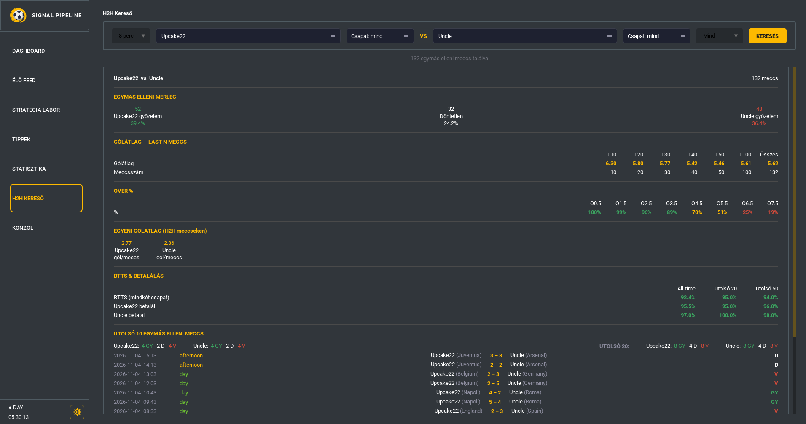

# esport-data-filter-pipeline

A desktop pipeline for esports football (Esoccer Battle, the EA FC 8 and 12 minute league): it
reads bookmaker prices, runs your strategies on them, sends the signals to Telegram, and settles
every signal from the official results. A dashboard shows health, signals and results, a
**Strategy Lab** builds rules without code, and a phone page lets you watch and restart it
remotely.

This is the skeleton of a system I run privately, published without its strategies, thresholds
or bookmaker scrapers. It ships with a demo odds source and one clearly labelled example
strategy, so the whole chain runs end to end out of the box.



## How it works



1. **Collect.** The Battle collector pulls finished results and upcoming fixtures from the public
   Battle API every 10 minutes. Months of history come in one step from the
   [esoccer-battle-mcp](https://github.com/Jhanee01/esoccer-battle-mcp) database or its public
   snapshot, instead of being scraped again.
2. **Price.** An odds source returns the open prices. The repo includes `DemoOddsSource`, which
   invents prices for the real upcoming fixtures. Real bookmaker scrapers are private plugins
   (see [docs/writing-an-odds-source.md](docs/writing-an-odds-source.md)).
3. **Decide.** Every strategy gets each offer plus features (head-to-head and form) computed only
   from matches that finished before kick-off.
4. **Signal.** A new signal is stored once per strategy and offer, and sent to the Telegram chat
   its routing points to: per strategy, per session (day / afternoon / night), or a default.
5. **Settle.** The resolver matches each signal to the Battle result (players in either order,
   kick-off within ±20 minutes) and marks it won, lost, push or void.

The last link of my own chain, placing the bets, is a separate tool:
[betplacer-standalone](https://github.com/Jhanee01/betplacer-standalone). It is not part of this
repo.

## Strategies

Strategies come from two places and run side by side:

- **Strategy Lab** (no code): pick a market and add conditions on features; it is saved as a
  JSON rule and backtested from the same screen.
- **Python plugins**: any `Strategy` subclass in a file under `strategies/`.









See [docs/writing-strategies.md](docs/writing-strategies.md) for the rule format, the plugin
interface and the list of features.

## Design decisions

- **No look-ahead, anywhere.** Live signals and backtests use the same feature function, which
  only sees matches that finished before the kick-off being evaluated.
- **Signals are idempotent.** The database allows one signal per (strategy, offer). A restart,
  an overlapping poll or a re-fetched price can't send the same tip twice.
- **One broken part doesn't stop the rest.** A strategy that raises, a plugin that fails to
  import, a Telegram error or an API hiccup is logged and shown on the dashboard; everything
  else keeps running.
- **The bookmaker is a plugin.** The pipeline only knows the `OddsSource` interface. That keeps
  site-specific scraping (and its terms-of-use questions) out of the core, and makes the whole
  chain testable with a fake source.
- **Honest backtests.** There is no historical odds data, so the backtest reports the hit rate
  and the break-even odds at an assumed price, rather than a profit figure that would only be
  as real as the price you typed in.
- **The schedule is data.** Turnus and session come from the Battle block schedule
  (`data/menetrend.json`, the same file esoccer-battle-mcp ships), not from the clock. The
  dashboard's turnus bar shows every block of the day and whether its results are in.
- **History is reused, not re-scraped.** The match table has the same columns as
  esoccer-battle-mcp, so a quarter of a million results import in a few seconds.

## Getting started

Requires Python 3.11+.

```bash
pip install -e ".[ui,remote,dev]"
cp .env.example .env                                  # optional: Telegram token, remote token
python -m signal_pipeline import-history --snapshot   # or plain import-history with a local MCP DB
python -m signal_pipeline collect                     # today's results and fixtures
python -m signal_pipeline ui                          # dashboard
```

Other commands:

```bash
python -m signal_pipeline run --remote        # headless, with the phone remote page
python -m signal_pipeline status              # health checks and per-strategy results
python -m signal_pipeline backtest example-h2h-edge --from 2026-10-01 --to 2026-10-31
```

Signals are only sent to Telegram once you set `TELEGRAM_TOKEN` and a chat on the
**Csatornák** tab; until then they are recorded locally.

## Phone remote

`run --remote` (or the dashboard with `REMOTE_TOKEN` set) serves a small page with the live log,
health and a restart button. It is meant for a private network such as Tailscale; every request
needs the token.

## Tests

```bash
pytest
ruff check .
```

The tests cover settling, features without look-ahead, rule validation, the plugin loader, the
engine (idempotence, started matches, a failing strategy), routing, the resolver, the backtest,
the Battle API parser, the history import, the remote page's auth and a dashboard smoke test.

## Notes

- The dashboard is the original tool's own UI code (sidebar, Dashboard, feed, tips, statistics,
  H2H search and console views). It reads its data through `ui/compat`, which serves the pipeline's
  database in the shapes those views expect, so the views themselves are kept as they were.
  The UI is in Hungarian, like the tool it was extracted from; the pipeline code and docs are
  in English.
- Results come from the unofficial public API behind football.esportsbattle.com. This project
  has nothing to do with Esports Battle, and the API may change.
- Nothing here is betting advice. Bet responsibly, and only where it is legal for you.

## License

MIT, see [LICENSE](LICENSE).
